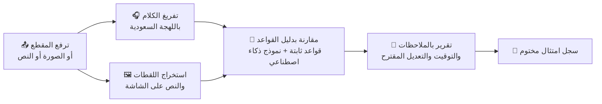

<div align="center">


# سَليم · SALEEM

### افحص قبل أن تنشر

مدقّق امتثال لصنّاع المحتوى والوكالات والعلامات التجارية في السعودية

[**🔗 جرّب الموقع**](https://saleem-app.vercel.app) &nbsp;·&nbsp; [**📄 شاهد تقريراً جاهزاً**](https://saleem-app.vercel.app/sample) &nbsp;·&nbsp; [English](#english)


</div>

<div dir="rtl">

## ما هو سَليم؟

قبل ما تنشر إعلانك أو مقطعك، ارفعه على سَليم. يحلّل **الكلام باللهجة السعودية**، و**اللقطات**، و**النص الظاهر على الشاشة**، و**الوصف**، ثم يقارنها بقواعد النشر والإعلان في السعودية، ويعطيك تقريراً واضحاً:

- 🕐 **أين المشكلة بالضبط**: كل ملاحظة مربوطة بالثانية في المقطع، تضغط عليها فيقفز الفيديو إليها.
- 📘 **لماذا هي مشكلة**: القاعدة المخالَفة ومصدرها الرسمي (موثوق، ضوابط المحتوى الإعلامي، حماية المستهلك، الإفصاح عن الذكاء الاصطناعي).
- 🔧 **كيف تصلحها**: تعديل مقترح جاهز لكل ملاحظة.
- 🔁 **أعد الفحص**: ارفع النسخة المعدّلة، وسَليم يوضح لك ما تم إصلاحه وما بقي.
- 🧾 **سجل امتثال موثّق**: سجل مختوم برقم مرجعي يمكن لأي جهة التحقق منه.

> [!NOTE]
> نتائج سَليم **تنبيهات استرشادية وليست موافقة رسمية**، والقرار النهائي لك. القواعد توضيحية وتنتظر المراجعة القانونية.

## كيف يعمل؟



1. **ترفع المحتوى** مع معلومات بسيطة: المنصة، هل هو إعلان مدفوع، نوع المنتج.
2. **سَليم يحلّل** الصوت واللقطات والنص في أقل من دقيقة تقريباً.
3. **تقرأ التقرير**: الحالة العامة (جاهز / يحتاج مراجعة / يحتاج تعديلات)، ثم كل ملاحظة مع دليلها.
4. **تعدّل وتعيد الفحص** حتى يصير المحتوى جاهزاً للنشر.

## الخصوصية

- اللقطات التي تُعرض كدليل **تُغبَّش على السيرفر** قبل أن تصل للمتصفح، لأنها قد تحتوي أشخاصاً أو أطفالاً.
- الملفات تُحذف تلقائياً بعد مدة محددة، ويمكن لصاحبها حذفها أو حذف حسابه بالكامل في أي وقت.
- كل مستخدم يرى بياناته فقط (Row Level Security في قاعدة البيانات).

## البنية التقنية

| الجزء | التقنية |
|---|---|
| الواجهة | React 19 + TypeScript، ‏Vite، ‏TanStack Router/Query، ‏Tailwind CSS v4، منشورة على **Vercel** |
| الخلفية | **Supabase**: ‏PostgreSQL + RLS، المصادقة، التخزين، Edge Functions، ومهام مجدولة |
| التحليل | Gemini (الكلام والإطارات والنص)، وقواعد عربية ثابتة تعمل بدون نموذج، ومحرك قواعد يطبّق القواعد السارية لكل الجهات تلقائياً |
| اللغة | العربية أولاً (RTL) مع الإنجليزية |
| الاختبارات | Vitest للوحدات، Playwright للواجهة (عربي/إنجليزي، حاسوب/جوال)، ومجموعة تقييم للدقة |

```text
frontend/   الواجهة: الصفحات في src/features، مكونات التصميم في src/components/ui، الوصول للبيانات في src/lib/api،
            الترجمة في src/i18n (ar.json هو المرجع؛ en.json يُحمَّل عند الحاجة)
backend/    Supabase: migrations (+ rollbacks)، functions (Edge Functions، والمشترك في functions/_shared)،
            tests (Vitest) و supabase/tests (pgTAP)، eval لقياس دقة التحليل
scripts/    أدوات التطوير: المكدّس المعزول للاختبارات، جولات المتصفح، توليد البيانات والشعار
docs/       القرارات، خطة V2 وتقدمها، السجلات القانونية — الفهرس في docs/README.md
```

</div>

<details>
<summary><b>🛠️ التشغيل محلياً (للمطورين)</b></summary>

<br/>

المتطلبات: Node 22، و Docker (لـ Supabase المحلي). مفتاح Gemini اختياري: بدونه تعمل التحليلات بمزوّد اختبار حتمي
لا يرسل أي طلب (انظر [`docs/GEMINI_INTEGRATION.md`](docs/GEMINI_INTEGRATION.md)).

```bash
npm ci
cp backend/.env.example backend/.env                                        # VITE_SUPABASE_URL + VITE_SUPABASE_PUBLISHABLE_KEY
cp backend/supabase/functions/.env.example backend/supabase/functions/.env  # GEMINI_API_KEY + GEMINI_MODEL (server-side)
npx supabase start --workdir backend           # قاعدة التطوير المحلية (المنافذ 5432x)
npm run demo:seed                              # الحسابات التجريبية (الأفراد والأدوار التسعة)
npm run dev                                    # http://localhost:3000
```

**الاختبارات تعمل على مكدّس معزول فقط** (`saleem_iso`، المنافذ 5442x) حتى لا تُمسّ بيانات قاعدة التطوير:

```bash
ISO_TEST_PROVIDER=1 node scripts/isolated-stack.mjs start     # مزوّد اختبار حتمي، بلا أي طلب ذكاء اصطناعي
node scripts/isolated-stack.mjs test                           # pgTAP (RLS والصلاحيات وسلامة القواعد)
node scripts/isolated-stack.mjs run -- npm --workspace backend test
npm --workspace frontend run test                              # وحدات الواجهة
npm --workspace frontend run e2e                               # Playwright: عربي/إنجليزي، حاسوب/جوال
npm run lint && npm --workspace frontend exec tsc -- --noEmit -p . && npm run build
npx --yes deno@2 check backend/supabase/functions/*/index.ts
npm --workspace backend run eval -- --deterministic-only       # دقة التحليل على حالات معروفة
```

جولات المتصفح الكاملة (على المكدّس المعزول عبر Vite على 3200): `scripts/personal-walkthrough.mjs` (رحلة الفرد كاملة)
و `scripts/check-demo-personas.mjs` (الأدوار التسعة).

**النشر:** الواجهة على Vercel (Root Directory: `frontend`، المتغيرات `VITE_*` فقط)، والخلفية على Supabase. الخطوات
والـ migrations المعلّقة وطريقة التراجع في [`docs/saleem-v2/RELEASE_PLAN.md`](docs/saleem-v2/RELEASE_PLAN.md). لا يُنشر
شيء ولا تُطبَّق migrations على المشروع المستضاف دون موافقة صريحة.

**أسرار Vault المطلوبة في قاعدة البيانات:** مهمة حذف الوسائط المجدولة (`saleem-cleanup-media`) تقرأ عنوان المشروع من سر Vault اسمه `project_url` (عنوان API للمشروع)، إضافةً إلى `cleanup_cron_secret` الذي تنشئه الـ migrations تلقائياً. أنشئه مرة واحدة من SQL Editor:
`select vault.create_secret('<project API URL>', 'project_url');` — إن لم يوجد، تتخطى المهمة التشغيل وتسجّل ملاحظة بدل استدعاء مشروع خاطئ.

</details>

<details>
<summary><b>📚 التوثيق</b></summary>

<br/>

- [`docs/saleem-v2/progress/FINAL_REPORT.md`](docs/saleem-v2/progress/FINAL_REPORT.md): ما تم بناؤه، والتحقق، ودليل النشر
- [`docs/DECISIONS.md`](docs/DECISIONS.md): كل قرار مع أسبابه والبدائل
- [`PROJECT_GUIDE.md`](PROJECT_GUIDE.md): دليل المشروع للمطوّرين
- [`docs/README.md`](docs/README.md): فهرس التوثيق (الحالي والتاريخي)

</details>

---

<a id="english"></a>

### English

**SALEEM** is a pre-publish compliance checker for Saudi creators, agencies and brands. Upload a short video, image or text; SALEEM analyses Saudi-dialect speech, frames, on-screen text and caption against Saudi publishing and advertising rules (Mawthooq, media content rules, consumer protection, AI disclosure) and returns **timed findings with official sources and suggested fixes**, a **re-check flow** that shows what you fixed, and a **verifiable compliance log**.

[Live site](https://saleem-app.vercel.app) · [Sample report](https://saleem-app.vercel.app/sample) · Built with React + TypeScript on Vercel and Supabase. Findings are advisory, not an official approval.
