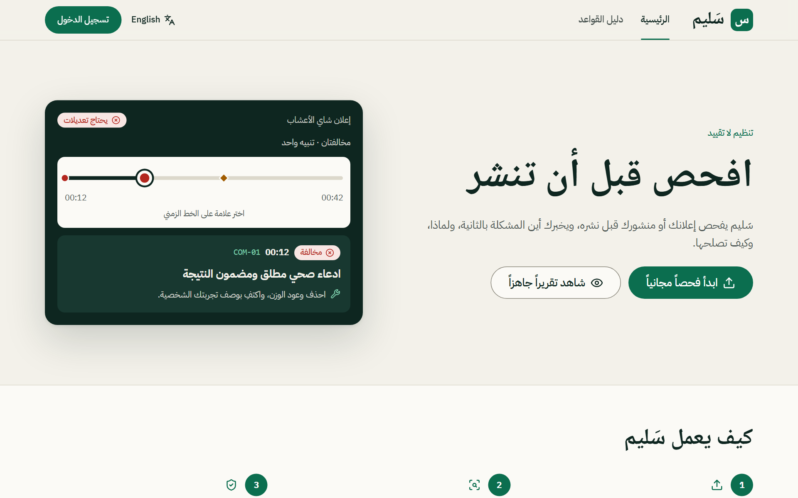
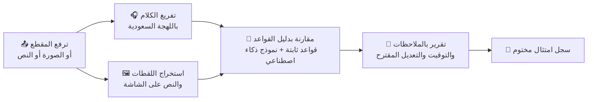
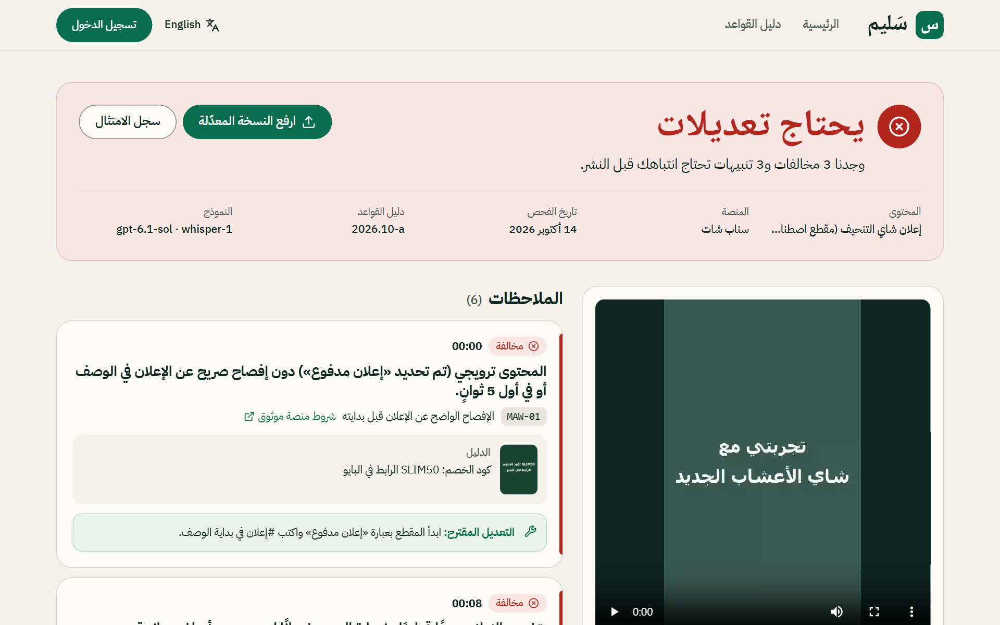
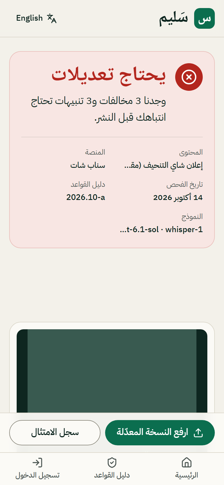
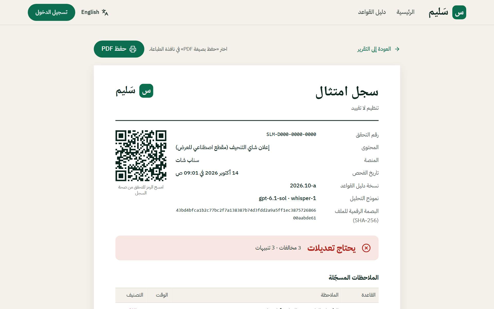

<div align="center">


# سَليم · SALEEM

### افحص قبل أن تنشر

مدقّق امتثال لصنّاع المحتوى والوكالات والعلامات التجارية في السعودية

[**🔗 جرّب الموقع**](https://saleem-app.vercel.app) &nbsp;·&nbsp; [**📄 شاهد تقريراً جاهزاً**](https://saleem-app.vercel.app/sample) &nbsp;·&nbsp; [English](#english)




</div>

<div dir="rtl">

## ما هو سَليم؟

قبل ما تنشر إعلانك أو مقطعك، ارفعه على سَليم. يحلّل **الكلام باللهجة السعودية**، و**اللقطات**، و**النص الظاهر على الشاشة**، و**الوصف**، ثم يقارنها بقواعد النشر والإعلان في السعودية، ويعطيك تقريراً واضحاً:

- 🕐 **أين المشكلة بالضبط**: كل ملاحظة مربوطة بالثانية في المقطع، تضغط عليها فيقفز الفيديو إليها.
- 📘 **لماذا هي مشكلة**: القاعدة المخالَفة ومصدرها الرسمي (موثوق، ضوابط المحتوى الإعلامي، حماية المستهلك، الإفصاح عن الذكاء الاصطناعي).
- 🔧 **كيف تصلحها**: تعديل مقترح جاهز لكل ملاحظة.
- 🔁 **أعد الفحص**: ارفع النسخة المعدّلة، وسَليم يوضح لك ما تم إصلاحه وما بقي.
- 🧾 **سجل امتثال موثّق**: سجل مختوم برقم مرجعي يمكن لأي جهة التحقق منه.

> [!NOTE]
> نتائج سَليم **تنبيهات استرشادية وليست موافقة رسمية**، والقرار النهائي لك. القواعد توضيحية وتنتظر المراجعة القانونية.

## كيف يعمل؟



1. **ترفع المحتوى** مع معلومات بسيطة: المنصة، هل هو إعلان مدفوع، نوع المنتج.
2. **سَليم يحلّل** الصوت واللقطات والنص في أقل من دقيقة تقريباً.
3. **تقرأ التقرير**: الحالة العامة (جاهز / يحتاج مراجعة / يحتاج تعديلات)، ثم كل ملاحظة مع دليلها.
4. **تعدّل وتعيد الفحص** حتى يصير المحتوى جاهزاً للنشر.

## لقطات

<table>
<tr>
<td width="68%"><br/><sub>التقرير: الحالة، الملاحظات مع الدليل والتعديل، والمقطع بجانبها</sub></td>
<td width="32%"><br/><sub>يعمل على الجوال</sub></td>
</tr>
<tr>
<td colspan="2"><br/><sub>سجل الامتثال المختوم</sub></td>
</tr>
</table>

## الخصوصية

- اللقطات التي تُعرض كدليل **تُغبَّش على السيرفر** قبل أن تصل للمتصفح، لأنها قد تحتوي أشخاصاً أو أطفالاً.
- الملفات تُحذف تلقائياً بعد مدة محددة، ويمكن لصاحبها حذفها أو حذف حسابه بالكامل في أي وقت.
- كل مستخدم يرى بياناته فقط (Row Level Security في قاعدة البيانات).

## البنية التقنية

| الجزء | التقنية |
|---|---|
| الواجهة | React 19 + TypeScript، ‏Vite، ‏TanStack Router/Query، ‏Tailwind CSS v4، منشورة على **Vercel** |
| الخلفية | **Supabase**: ‏PostgreSQL + RLS، المصادقة، التخزين، Edge Functions، ومهام مجدولة |
| التحليل | تفريغ صوتي (Whisper)، نموذج رؤية ولغة، وقواعد عربية ثابتة تعمل بدون نموذج |
| اللغة | العربية أولاً (RTL) مع الإنجليزية |
| الاختبارات | Vitest للوحدات، Playwright للواجهة (عربي/إنجليزي، حاسوب/جوال)، ومجموعة تقييم للدقة |

```text
frontend/   الواجهة: الصفحات في src/features، مكونات التصميم في src/components/ui، الترجمة في src/i18n
backend/    Supabase: migrations للقاعدة، functions للتحليل، eval لقياس الدقة، tests
docs/       القرارات، التشغيل، نظام التصميم، والتقرير النهائي
```

</div>

<details>
<summary><b>🛠️ التشغيل محلياً (للمطورين)</b></summary>

<br/>

المتطلبات: Node 22، مشروع Supabase، ومفتاح OpenAI.

```bash
npm ci
cp backend/.env.example backend/.env                                        # VITE_SUPABASE_URL + VITE_SUPABASE_PUBLISHABLE_KEY
cp backend/supabase/functions/.env.example backend/supabase/functions/.env  # OPENAI_API_KEY
npx supabase link --project-ref <ref> --workdir backend
npx supabase db push --workdir backend
npx supabase secrets set --env-file backend/supabase/functions/.env --workdir backend
npx supabase functions deploy --workdir backend
npm run dev        # http://localhost:3000
```

| الأمر | الوظيفة |
|---|---|
| `npm test` | اختبارات الوحدات |
| `npm --workspace frontend run e2e` | اختبارات الواجهة (Playwright) |
| `npm --workspace backend run eval` | قياس دقة التحليل على حالات معروفة |
| `npm run seed:backend` | إنشاء حساب العرض التجريبي (`demo@saleem.app`) |

**النشر:** الواجهة على Vercel (Root Directory: `frontend`، المتغيرات `VITE_*` فقط)، والخلفية على Supabase. التفاصيل في [`docs/OPERATIONS.md`](docs/OPERATIONS.md).

</details>

<details>
<summary><b>📚 التوثيق</b></summary>

<br/>

- [`docs/FINAL_REPORT.md`](docs/FINAL_REPORT.md): ما تم بناؤه، الأدلة، والمسائل المفتوحة
- [`docs/DECISIONS.md`](docs/DECISIONS.md): كل قرار مع أسبابه والبدائل
- [`docs/OPERATIONS.md`](docs/OPERATIONS.md): البيئات، الاستضافة، الأسرار، النسخ الاحتياطي
- [`docs/DESIGN_SYSTEM.md`](docs/DESIGN_SYSTEM.md): الألوان، الخطوط، والمكونات

</details>

---

<a id="english"></a>

### English

**SALEEM** is a pre-publish compliance checker for Saudi creators, agencies and brands. Upload a short video, image or text; SALEEM analyses Saudi-dialect speech, frames, on-screen text and caption against Saudi publishing and advertising rules (Mawthooq, media content rules, consumer protection, AI disclosure) and returns **timed findings with official sources and suggested fixes**, a **re-check flow** that shows what you fixed, and a **verifiable compliance log**.

[Live site](https://saleem-app.vercel.app) · [Sample report](https://saleem-app.vercel.app/sample) · Built with React + TypeScript on Vercel and Supabase. Findings are advisory, not an official approval.
