# SALEEM — final report

Run: 2026-10-14, autonomous (phases 1 → 7). Branches `phase-1-audit` … `phase-7-demo`, each merged into
`master` (Phase 6 was committed directly on `master`; `phase-6-quality` marks that commit).
Details: `docs/PROGRESS.md` (per phase, with evidence) and `docs/DECISIONS.md` (D1–D60).

## 1. Summary per phase

| Phase | Result |
|---|---|
| 1 Audit | `docs/AUDIT.md`: 19 functional defects (e.g. analyze called with a non-JWT key, silent mock fallbacks, no frames ever sent, media never deleted), fake progress, hardcoded log, no routing/i18n/mobile nav. 36 before-screenshots. |
| 2 Design system | Tokens + semantic tokens (WCAG-checked; 2 tokens added to fix AA), self-hosted Arabic fonts, type scale, 30 primitives, `/styleguide`, typed i18n with Arabic plurals. Lint 4,930 → 0 errors. |
| 3 Screens | All screens rebuilt on the system with real URL routes, auth and data: report (synced player/timeline/cards/transcript), ready diff, new check, live processing, dashboard, A4 log with QR, rulebook, landing, auth, settings. All mocks removed outside demo rows. |
| 4 Pipeline | Real OpenAI pipeline (whisper-1 + gpt-6.1-sol, strict JSON), browser frame/audio extraction, Arabic deterministic checks, merge rules, resumable function with auth, rate limit, cancel/retry, cost/tokens/durations, integrity hardening (owners can no longer forge reports), hourly media cleanup cron, eval harness + admin page, clip runner. |
| 5 Features | Settings (export, delete, password), archive audit + CSV, agency workspaces (roles, invites, campaigns, org RLS), brand share links + approvals, rulebook versioning admin + re-run, public `/verify`, notifications, plans & quotas (DB-enforced), legal pages. |
| 6 Quality | Audit log, watchdog cron, admin metrics, telemetry interface, prerendering + chunking, 33 E2E tests (AR/EN, desktop/mobile), CI workflow, hosting configs, operations guide, 0 npm vulnerabilities. |
| 7 Demo | Demo pair from real pipeline output on synthetic clips (with video), demo script, accuracy summary, final screenshots. |

## 2. Before / after

| Screen | Before | After |
|---|---|---|
| Report (needs fixes) | 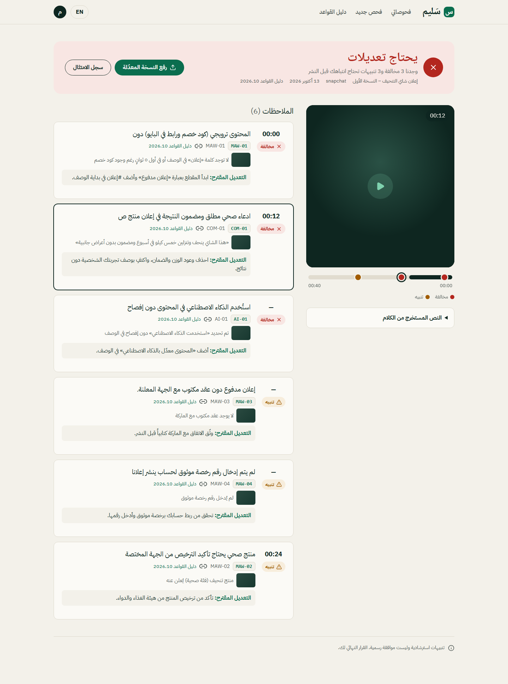 | 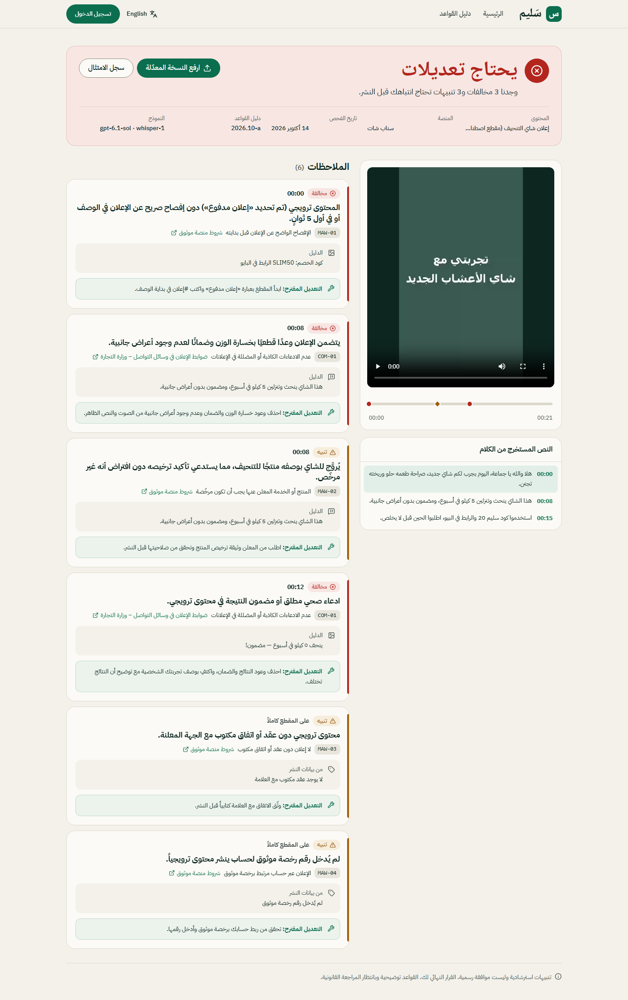 |
| Report (mobile, EN) | 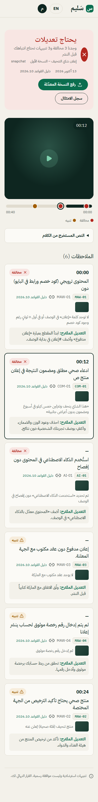 | 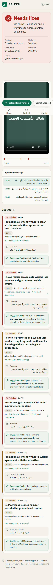 |
| Ready / re-check | 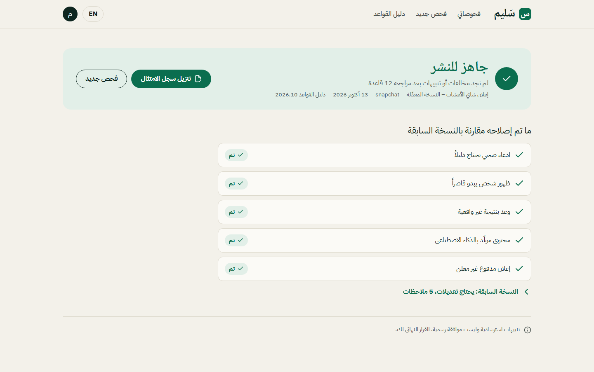 | 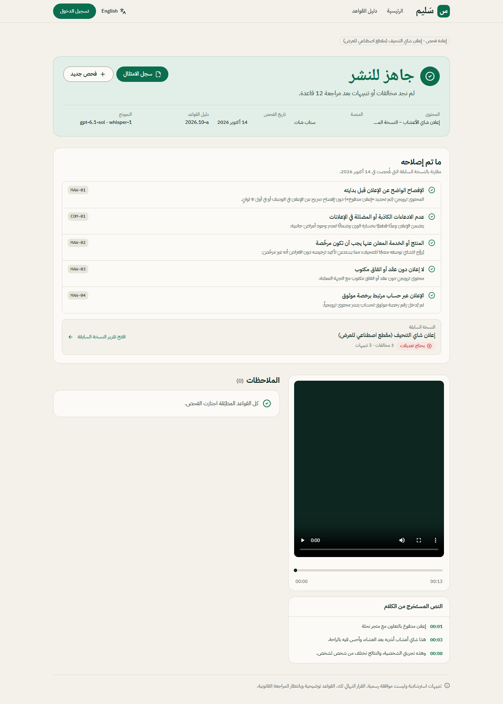 |
| New check | 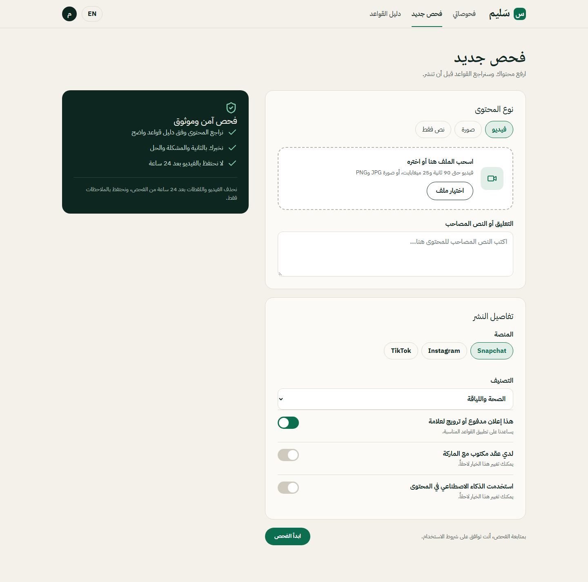 | 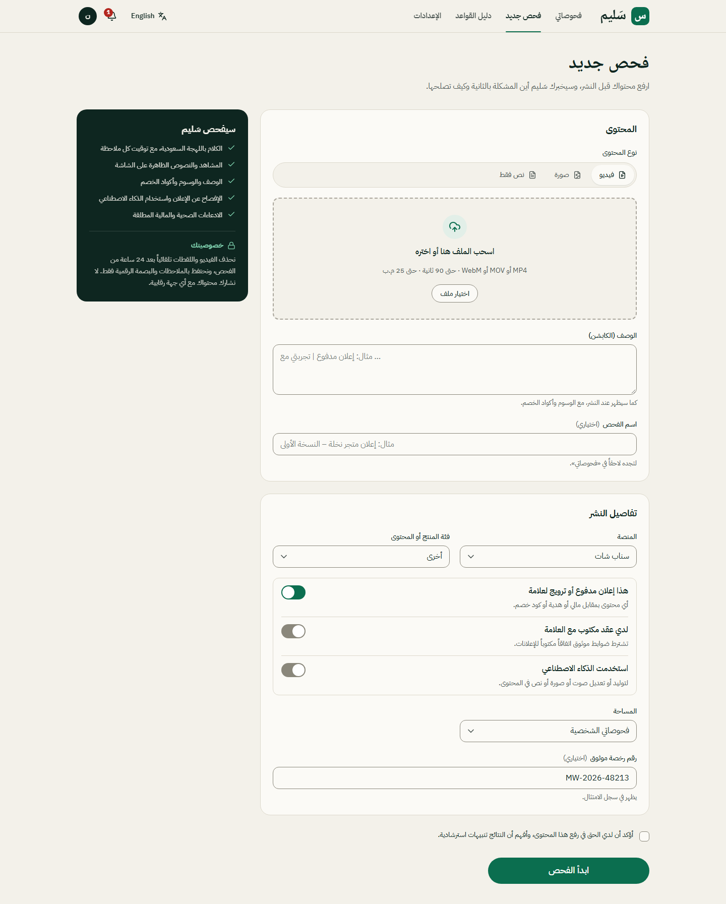 |
| Dashboard | 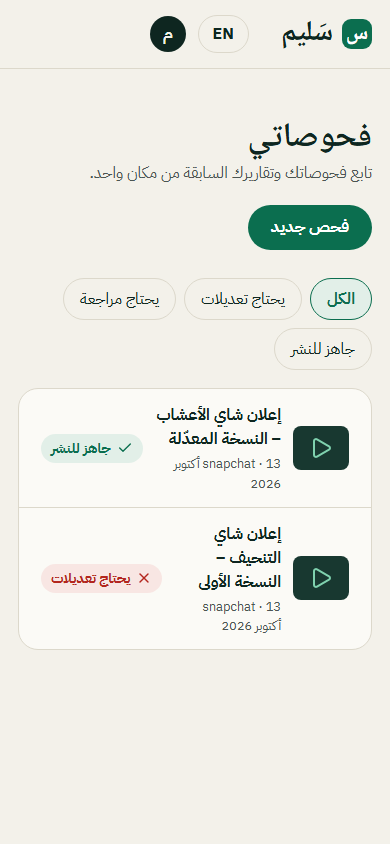 | 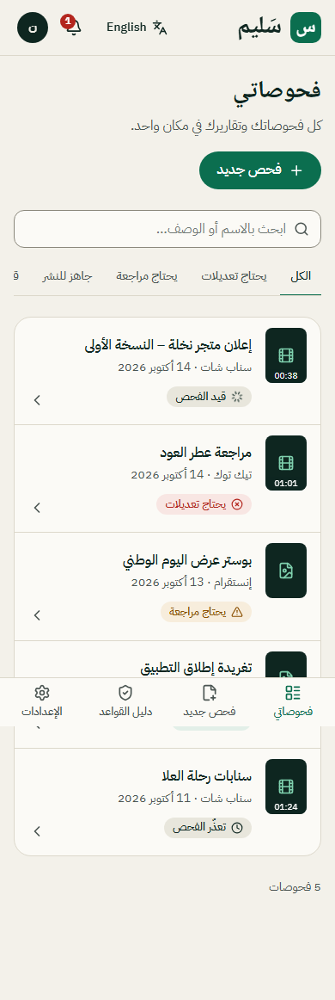 |
| Compliance log | 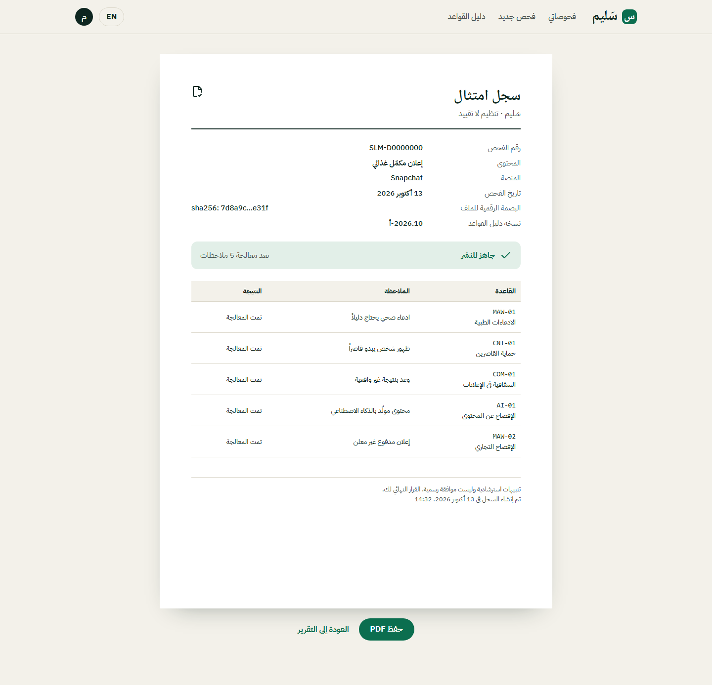 | 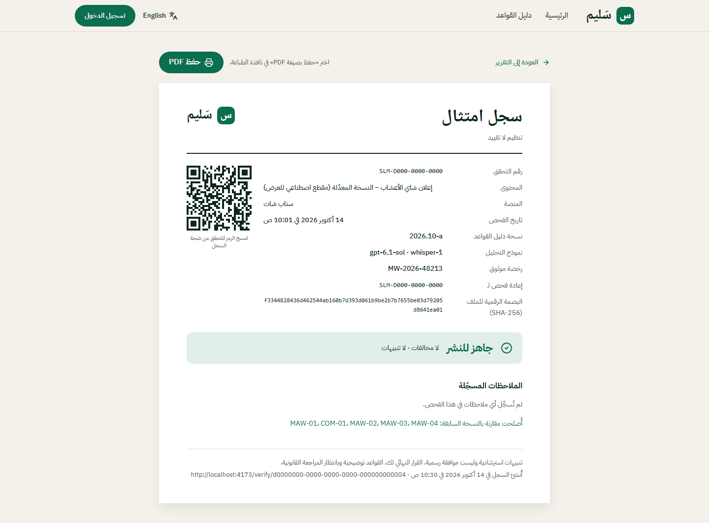 |
| Landing | 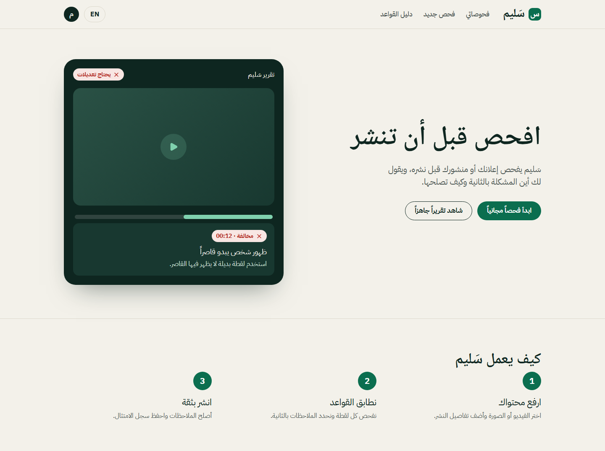 | 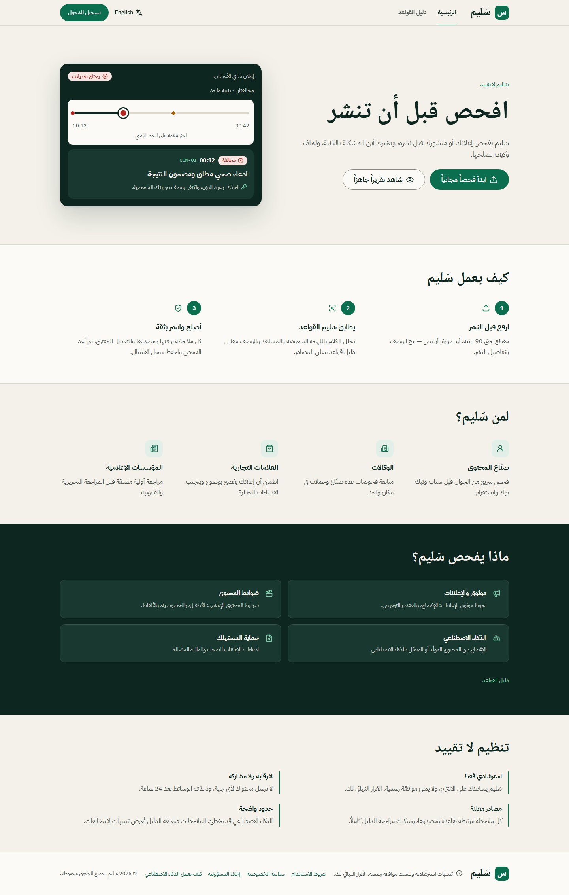 |

All screenshots: `docs/audit/before/` (36), `docs/screens/phase2..5/`, `docs/demo/final/` (60: 15 screens × desktop/mobile × AR/EN).
Every capture run reported zero console errors and zero failed requests; no horizontal overflow at 390 px.

## 3. Test results (final run)

| Suite | Result |
|---|---|
| TypeScript (strict) | pass |
| ESLint | 0 errors (17 react-refresh warnings) |
| Frontend Vitest | 22 / 22 |
| Backend Vitest (Arabic fixtures, schema, merge, cost) | 42 pass, 7 skipped (live isolation — need test accounts) |
| Deno check (3 Edge Functions) | pass |
| Playwright E2E | 33 / 33 (11 flows × ar-desktop, en-desktop, ar-mobile) |
| `npm audit` | 0 vulnerabilities |
| Lighthouse desktop | perf 97 / 97 / 85 (landing / rules / report); a11y 95–100; best-practices 100; SEO 100 |
| Lighthouse mobile | a11y 95–100, BP 100, SEO 100; **perf ~70 simulated (target ≥ 90 not met)** — see §5 |

## 4. Real-clip results

- **Your Saudi-dialect clips were not in the repo** (`backend/tests/fixtures/` didn't exist), so none were run.
- Synthetic stand-ins (TTS Saudi-dialect speech + Arabic slides) through the full path
  (`docs/demo/CLIPS.md`, raw JSON in `docs/demo/clips/`):
  - "Slimming tea" 22 s → needs fixes, 6 findings, 5/5 expected rules, claim at 8.2 s, ~30 s, $0.016–0.027.
  - Fixed version 13 s → ready, 0 findings, ~15 s, $0.006–0.014.
- Text-mode evaluation (`docs/demo/ACCURACY.md`): 12 cases, recall 100 %, precision 94 %, timestamp error 0 s,
  $0.0057 and 7.5 s per check; rules-only baseline 53 % recall.
- To run yours: put `.mp4/.mov/.webm` in `backend/tests/fixtures/` (+ optional `<clip>.json` sidecar with
  post details and expected rules) and run `npm --workspace backend run clips`.

## 5. Open issues

1. **Mobile Lighthouse performance ~70 (target ≥ 90).** Real throttled FCP ≈ 1.9 s after prerendering, but LCP
   is re-counted when React replaces the prerendered heading after the Arabic web font arrives. Fix: real
   SSR/SSG with hydration, or metric-matched fallback fonts (`size-adjust`) for IBM Plex / Noto Naskh.
2. **Not proven live end-to-end through the deployed function by a signed-in user**: no test accounts could be
   created (Supabase rejects example.com; I didn't use real mailboxes). The same modules were proven live via the
   eval harness, smoke test and clip runner; signed-in UI flows were proven with network mocks.
3. **Live RLS/storage isolation tests** are written but skipped until two test accounts exist.
4. Org / share / re-run / account-deletion flows are verified against the live DB only at the RPC level
   (permission denials, valid/invalid tokens), not end-to-end as two real users.
5. One known model false alarm (perfume "lasts all day" → COM-01); Whisper can mis-hear dialect words in
   compressed audio.
6. Rule sources point to authority homepages and are flagged `source_verified=false`; all 12 rules are
   `illustrative_pending_review`.
7. Legacy docs `docs/ARCHITECTURE.md`, `CLEANUP_*`, `PARITY_CHECKLIST.md` predate this work and are outdated.
8. CI has not run on GitHub (no remote configured).

## 6. What you must do manually

**Secrets & accounts**
1. Create the demo user (Dashboard → Auth → Add user `demo@saleem.app` / `demo123456`, auto-confirm) or run
   `SUPABASE_SERVICE_ROLE_KEY=… npm run seed:backend` in your shell. Until then "Try the demo account" shows a
   clear message; demo *reports* work without it.
2. Make yourself admin: `insert into public.user_roles (user_id, role) values ('<your uuid>', 'admin');`
   (the old "first sign-up becomes admin" trigger was removed for safety).
3. Create two confirmed **test accounts on a staging project** and add `TEST_USER_A_EMAIL/PASSWORD`,
   `TEST_USER_B_EMAIL/PASSWORD` to `backend/.env`; run `npm --workspace backend test` (isolation suite).
4. Give one account the Agency plan to try workspaces: `update profiles set plan_id='agency' where id='<uuid>';`
5. Optional: `SUPABASE_SERVICE_ROLE_KEY` in your shell + `npm --workspace backend run eval -- --upload` to fill
   `/admin/eval` from the database.
6. Email: create a Resend account, verify a domain, set `EMAIL_PROVIDER=resend`, `RESEND_API_KEY`, `EMAIL_FROM`,
   `APP_URL` as function secrets (docs/OPERATIONS.md §6).
7. Error tracking: create a Sentry project and wire `setErrorReporter()` (OPERATIONS §7).
8. Set an OpenAI usage limit / budget alert for the key used by the functions.

**Deployment**
9. Push the repo to GitHub, add repository variables `VITE_SUPABASE_URL` and `VITE_SUPABASE_PUBLISHABLE_KEY`
   so CI runs.
10. Pick a host (Vercel or Cloudflare Pages; configs included), set the build to `npm --workspace frontend run build`
    (output `frontend/dist`), and add the production URL in Supabase Auth → URL configuration.
11. Create a staging Supabase project; apply migrations and deploy functions there (README).
12. Enable Point-in-Time Recovery on production; decide on domain (`saleem.sa`).

**Content & legal**
13. Legal review of the 12 rules, their sources and the legal pages (fill every `[ ]` placeholder, PDPL
    controller/processor/transfer details).
14. Add consented real creator clips to `backend/tests/fixtures/` and run `npm --workspace backend run clips`
    and `eval` before any public accuracy claim.

## 7. Hosted changes made during this run

- Migrations applied (all additive): `20261014000000_pipeline_hardening`, `20261014010000_rule_instructions_cnt01`,
  `20261014020000_product_features`, `20261014030000_quality`, `20261014040000_demo_pipeline_pair`.
- Edge Functions deployed: `analyze` (JWT on), `cleanup-media` (JWT verified in code), `account` (new).
- Function secrets set: `LLM_PROVIDER=openai`, `LLM_MODEL=gpt-6.1-sol`, `LLM_REASONING_EFFORT=medium`,
  `TRANSCRIPTION_PROVIDER=openai`, `TRANSCRIPTION_MODEL=whisper-1` (the OpenAI key was not touched).
- pg_cron jobs: `saleem-cleanup-media` (hourly), `saleem-fail-stuck` (every 5 min). Vault secret
  `cleanup_cron_secret` generated inside the database.
- No tables dropped, no user data deleted, no database reset. OpenAI spend during the run: well under $1
  (smoke tests, two eval runs, clip runs, TTS).
