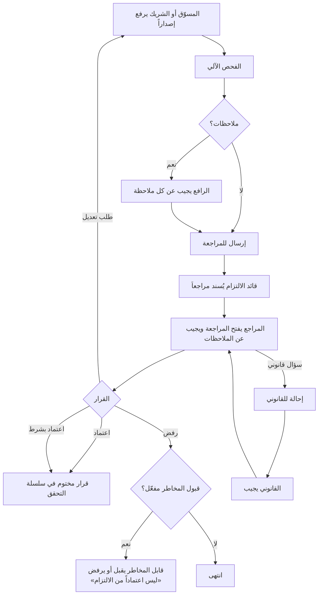
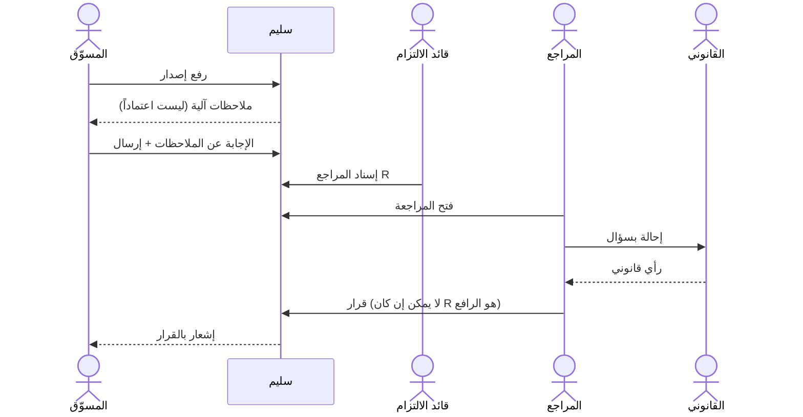
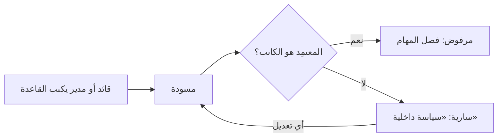

# الأدوار ومسار العمل في سليم

> مصدر الحقيقة: `frontend/src/lib/permissions.ts`. الجدول نفسه مطبّق في قاعدة البيانات بالدالة `public.org_can`
> (الملف `backend/supabase/migrations/20261118080500_v2_org_can.sql`)، واختبار مولَّد يتحقق من كل خانة:
> `backend/supabase/tests/p8_roles_matrix.test.sql` (153 خانة، و99 محاولة ممنوعة على الدوال والجداول الحقيقية).
> لإعادة التوليد بعد تعديل الجدول: `node --experimental-strip-types backend/scripts/gen-permission-tests.mjs`.

## الأدوار

| الدور | الرمز | باختصار |
|---|---|---|
| المالك | `owner` | يملك المساحة. كل الصلاحيات، ومنها منح دور المالك. |
| مدير المنظمة | `admin` | الأعضاء والإعدادات والمنتجات والميزات، ويراجع ويعتمد. لا يمنح دور المالك. |
| قائد الالتزام | `compliance_lead` | كل ما يفعله المراجع، ويُسند المراجعات، ويدير حزم القواعد وقواعد الشركة ويعتمدها. |
| مراجع الالتزام | `reviewer` | يراجع ويقرّر (اعتماد، طلب تعديل، رفض)، ولا يقرّر في إعلان رفعه بنفسه. |
| القانوني | `legal` | يجيب عن الإحالات القانونية ويطّلع على الإعلانات. لا يعتمد. |
| قابل المخاطر | صلاحية `can_accept_risk` | ليست دوراً. تُمنح لعضو داخلي (مالك، مدير، قائد، مراجع، قانوني) ليقبل مخاطر إعلان مرفوض. «قبول مخاطر — ليس اعتماداً من الالتزام». |
| المسوّق (الرافع) | `creator` | يرفع الإعلانات، ويجيب عن الملاحظات، ويرسل للمراجعة. يرى إعلاناته فقط. |
| شريك خارجي | `external_uploader` | من خارج المنظمة. يرفع عبر رابط الشريك فقط ويرى إرسالاته فقط. |
| مراجع خارجي | `external_reviewer` | من خارج المنظمة. يرى ما شُورك معه فقط. |
| مطّلع / مدقق | `viewer` | يقرأ كل ما يقرؤه الأعضاء الداخليون، ويرى التحليلات، ولا يغيّر شيئاً. |
| مشرف المنصة | `user_roles.role = admin` | خارج المنظمات: ينشر إصدارات القواعد، وتقرير المعايرة. لا يعتمد إعلانات أي منظمة. |

## جدول الصلاحيات

✓ مسموح · ◐ بشرط (يتحقق منه الخادم) · — غير مسموح

| الإجراء | مالك | مدير | قائد | مراجع | قانوني | مسوّق | شريك | مراجع خارجي | مطّلع |
|---|---|---|---|---|---|---|---|---|---|
| عرض الإعلانات | ✓ | ✓ | ✓ | ✓ | ✓ | ◐ إعلاناته | ◐ إرسالاته | ◐ ما شُورك | ✓ |
| إنشاء إعلان | ✓ | ✓ | — | — | — | ✓ | ◐ عبر الرابط | — | — |
| إرسال للمراجعة | ✓ | ✓ | ◐ إعلاناته | ◐ إعلاناته | ◐ إعلاناته | ✓ | ◐ إعلاناته | — | — |
| طلب تعديل في تعليق | ✓ | ✓ | ✓ | ✓ | — | — | — | — | — |
| التعليق | ✓ | ✓ | ✓ | ✓ | ✓ | ◐ ما يراه | ◐ ما يراه | ◐ ما يراه | — |
| قرار المراجعة | ◐ | ◐ | ◐ | ◐ | — | — | — | — | — |
| إسناد المراجع | ✓ | ✓ | ✓ | — | — | — | — | — | — |
| إحالة للقانوني | ◐ | ◐ | ◐ | ◐ | — | — | — | — | — |
| الرأي القانوني | — | — | — | — | ✓ | — | — | — | — |
| قبول المخاطر | ◐ | ◐ | ◐ | ◐ | ◐ | — | — | — | — |
| الأعضاء والأدوار | ✓ | ◐ ليس المالك | — | — | — | — | — | — | — |
| حزم القواعد والاستثناءات | ✓ | ✓ | ✓ | — | — | — | — | — | — |
| كتابة قواعد الشركة | ✓ | ✓ | ✓ | — | — | — | — | — | — |
| اعتماد قواعد الشركة | ◐ | ◐ | ◐ | — | — | — | — | — | — |
| المنتجات | ✓ | ✓ | — | — | — | — | — | — | — |
| الإعدادات والميزات والتكاملات | ✓ | ✓ | — | — | — | — | — | — | — |
| التحليلات | ✓ | ✓ | ✓ | ✓ | — | — | — | — | ✓ |

الشروط:
- **قرار المراجعة:** ليس رافع الإعلان (فصل المهام)، ولا يوجد مسار اعتماد متعدد المراحل (يقرّر عندها أصحاب المراحل).
- **الإحالة للقانوني:** الإعلان قيد المراجعة، والمُحيل ليس رافعه.
- **قبول المخاطر:** العضو يملك صلاحية «قابل المخاطر»، والميزة `risk_acceptance` مفعّلة.
- **الأعضاء والأدوار:** مدير المنظمة لا يمنح دور المالك ولا يغيّر دور مالك. لا يُزال آخر مالك.
- **اعتماد قواعد الشركة:** ليس كاتب القاعدة (آخر من عدّلها). كل تعديل يعيد القاعدة مسودة.

كل تغيير دور، وكل دعوة، يُسجَّل في `audit_events` (المشغّل `audit_org_members` و`audit_org_invites`).

## مسار الإعلان

## من يفعل ماذا (تسلسل)

## قواعد الشركة

## ترحيل المستخدمين الحاليين

لم يتغيّر أي دور قائم. أُضيفت قيمتان جديدتان فقط (`compliance_lead` و`viewer`)، فبقي كل عضو على دوره، مع تغيير
الاسم المعروض لأربعة أدوار:

| الدور القديم | الدور الجديد | الاسم المعروض الآن |
|---|---|---|
| `owner` | `owner` | المالك |
| `admin` | `admin` | مدير المنظمة (كان «مشرف») |
| `reviewer` | `reviewer` | مراجع الالتزام (كان «مراجع») |
| `legal` | `legal` | القانوني |
| `creator` | `creator` | المسوّق (الرافع) (كان «صانع محتوى») |
| `external_uploader` | `external_uploader` | شريك خارجي (كان «رافع خارجي») |
| `external_reviewer` | `external_reviewer` | مراجع خارجي |
| `can_accept_risk = true` | الصلاحية نفسها | قابل المخاطر |
| — | `compliance_lead` | جديد: لا يُمنح تلقائياً. يمنحه المالك أو مدير المنظمة من صفحة المساحة. |
| — | `viewer` | جديد: لا يُمنح تلقائياً. |

العدد الفعلي لكل دور على قاعدة الإنتاج يُستخرج عند النشر بالاستعلام
`select role, count(*) from org_members group by role;` ويُسجَّل في تقرير المرحلة 8.
